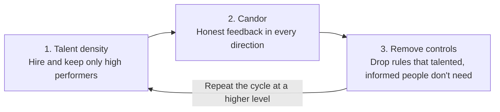

---

# EXAMPLE ENTRY: replace the notes with your own, then set draft: false to publish.
title: "Notes on No Rules Rules"
date: 2026-05-10
draft: true
book:
  title: "No Rules Rules"
  author: "Reed Hastings & Erin Meyer"
  year: 2020
  pages: 272
category: business
status: queued 
spine: "#B20710"
translationKey: no-rules-rules

---

The book is built on a three-step cycle, repeated at ever-higher levels:
 

 
Each step only works because of the one before it. Removing controls without talent density and candor creates chaos; candor among weak performers creates pain without improvement.
 
## High performance + selfless candor
 
The culture rests on two pillars: a team made only of high performers, and the habit of telling each other the truth for the other person's benefit.
 
### High performance (talent density)
 
- **One great performer beats several average ones.** Average performers drag down the whole team's energy and output; a dense team learns from itself.
- **Pay top of market** for creative roles, so you attract and keep the best. Netflix prefers higher salaries over bonuses tied to targets.
- **The keeper test:** *If this person told me they were leaving, would I fight hard to keep them?* If not, give them a generous severance now and free the seat for someone you would fight for.
- **A team, not a family.** Netflix compares itself to a professional sports team: everyone must earn their place every season.
- **No brilliant jerks.** Talent never excuses behavior that damages trust and collaboration.
### Selfless candor
 
- **Say it to their face.** Only say about someone what you would say directly to them; complaining behind someone's back is treated as disloyal.
- **Selfless** means the feedback serves the other person and the company, not your ego or your need to vent.
- **Feedback in every direction,** especially upward. Leaders go first, ask for feedback often, and react with thanks, which makes it safe for everyone else.
- **Make it routine:** live 360s (start / stop / continue, delivered in person) and leaders "sunshining" their own mistakes in public.
- **Disagreeing silently** is seen as withholding value from the company.
## The 4A feedback guidelines
 
The 4As turn candor into something useful rather than hurtful: two rules for the person giving feedback, two for the person receiving it.
 
| Role | Guideline | What it means in practice |
| --- | --- | --- |
| Giving | **Aim to assist** | Feedback must have positive intent: help the person or the company. Explain how the change would help them; never use it to vent, hurt, or score points. |
| Giving | **Actionable** | Say what the person can do differently, not just what is wrong. "Your intro ran 10 minutes and people lost focus" beats "your talk was boring". |
| Receiving | **Appreciate** | The natural reaction is defensiveness. Instead, listen carefully, stay open, and thank the person for the courage it took. |
| Receiving | **Accept or discard** | You must listen and consider all feedback, but you don't have to follow it. The decision of what to act on stays with the receiver. |
 
The book adds that cultural context matters (Erin Meyer's specialty): the same direct feedback lands differently in the Netherlands than in Japan, so adapt the delivery while keeping the substance.
 
## Freedom and responsibility
 
Every freedom Netflix grants comes with an equally clear responsibility, and both are spelled out so nobody can misread one without the other.
 
### Freedom: removing controls
 
| Control removed | The freedom | The responsibility that comes with it |
| --- | --- | --- |
| Vacation policy | Take time off whenever you want | Make sure your team and work are covered; leaders model it by taking visible vacations |
| Travel and expense approvals | Spend company money without sign-off | "Act in Netflix's best interest": spend as if it were your own money; abuse is a firing offense |
| Decision approvals | Make big calls without your boss's sign-off | Own the outcome and gather input before deciding |
| Contract sign-offs | Sign deals yourself | Know the context well enough to commit the company |
 
### How decisions get made
 
- **Lead with context, not control.** Instead of telling people what to do, leaders share the strategy, priorities, and stakes, then let them decide.
- **Highly aligned, loosely coupled.** Teams agree on the goal (aligned) but act without central coordination (loosely coupled).
- **The informed captain.** Each decision has one owner who gathers input and decides; it is not made by consensus or by the boss.
- **Farm for dissent, socialize, test.** Before a big bet, actively seek disagreement, share the idea widely, and run a small test when possible.
- **Don't seek to please your boss.** Seek to do what is best for the company.
- **Celebrate wins, sunshine failures.** When a bet fails, the owner explains openly what happened and what they learned, without blame.
### Making both sides obvious
 
Freedom without stated responsibility turns into abuse; responsibility without freedom turns into bureaucracy. Netflix keeps both visible: the rule is short, the expectation is explicit, and the consequence of abuse is known.
 
## Where it applies, and where it doesn't
 
Hastings is explicit that F&R is built for innovation, not for error prevention.
 
- **Use F&R** when the goal is creativity, speed, and flexibility, and a mistake is recoverable.
- **Use rules and process** where one error is catastrophic: safety-critical operations (his examples include hospitals and nuclear plants), and by extension areas like security and compliance controls.
- **In mixed teams,** the practical reading is: freedom on *how* to reach the goal, firm guardrails on the few things that must never fail.
- **Order matters.** Talent density and candor come first; removing controls before those are in place creates chaos.

**Common criticisms:** the keeper test can create fear and job insecurity; candor depends heavily on culture and psychological safety; and the model assumes the money to pay top of market.
