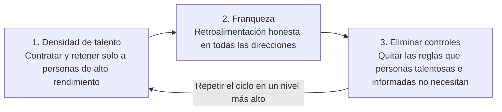

---
# Traducción de las notas en inglés (src/content/books/en/no-rules-rules.md).
# Pon draft: false para publicarla junto con la versión en inglés.
title: "Notas sobre No Rules Rules"
date: 2026-05-10
draft: true
book:
  title: "No Rules Rules"
  author: "Reed Hastings & Erin Meyer"
  year: 2020
  pages: 272
category: business
status: queued
spine: "#B20710"
translationKey: no-rules-rules
---

El libro se apoya en un ciclo de tres pasos que se repite en niveles cada vez más altos:

Cada paso solo funciona gracias al anterior. Eliminar controles sin densidad de talento ni franqueza genera caos; la franqueza entre personas de bajo rendimiento causa dolor sin mejora.

## Alto rendimiento + franqueza desinteresada

La cultura descansa sobre dos pilares: un equipo formado solo por personas de alto rendimiento y la costumbre de decirse la verdad en beneficio del otro.

### Alto rendimiento (densidad de talento)

- **Una persona excelente rinde más que varias promedio.** Las personas de rendimiento promedio bajan la energía y los resultados de todo el equipo; un equipo denso aprende de sí mismo.
- **Pagar lo más alto del mercado** en los roles creativos, para atraer y retener a los mejores. Netflix prefiere salarios más altos a bonos atados a metas.
- **La prueba del custodio (keeper test):** *si esta persona me dijera que se va, ¿lucharía por retenerla?* Si la respuesta es no, ofrécele ahora una liquidación generosa y libera el puesto para alguien por quien sí lucharías.
- **Un equipo, no una familia.** Netflix se compara con un equipo deportivo profesional: cada persona tiene que ganarse su lugar en cada temporada.
- **Nada de genios imbéciles (brilliant jerks).** El talento nunca justifica conductas que dañan la confianza y la colaboración.

### Franqueza desinteresada

- **Decirlo a la cara.** Solo se dice de alguien lo que se le diría directamente; quejarse a espaldas de alguien se considera una deslealtad.
- **Desinteresada** significa que la retroalimentación sirve a la otra persona y a la empresa, no a tu ego ni a tu necesidad de desahogarte.
- **Retroalimentación en todas las direcciones,** sobre todo hacia arriba. Los líderes van primero, piden retroalimentación a menudo y responden agradeciendo, lo que la vuelve segura para todos los demás.
- **Volverlo rutina:** evaluaciones 360 en vivo (empezar / dejar de / continuar, dichas en persona) y líderes que sacan a la luz (sunshining) sus propios errores en público.
- **Estar en desacuerdo en silencio** se ve como privar a la empresa de algo valioso.

## Las pautas 4A para la retroalimentación

Las 4A convierten la franqueza en algo útil en lugar de hiriente: dos reglas para quien da la retroalimentación y dos para quien la recibe.

| Rol | Pauta | Qué significa en la práctica |
| --- | --- | --- |
| Dar | **Aspirar a ayudar** | La retroalimentación debe tener una intención positiva: ayudar a la persona o a la empresa. Explica cómo el cambio la ayudaría; nunca la uses para desahogarte, herir o ganar puntos. |
| Dar | **Accionable** | Di qué puede hacer la persona de otra forma, no solo qué está mal. "Tu introducción duró 10 minutos y la gente perdió la atención" es mejor que "tu charla fue aburrida". |
| Recibir | **Agradecer** | La reacción natural es ponerse a la defensiva. En su lugar, escucha con atención, mantente abierto y agradece el valor que le tomó a la otra persona decírtelo. |
| Recibir | **Aceptar o descartar** | Debes escuchar y considerar toda la retroalimentación, pero no estás obligado a seguirla. La decisión de qué hacer con ella es de quien la recibe. |

El libro añade que el contexto cultural importa (la especialidad de Erin Meyer): la misma retroalimentación directa se recibe distinto en los Países Bajos que en Japón, así que hay que adaptar la forma sin cambiar el fondo.

## Libertad y responsabilidad

Cada libertad que da Netflix viene con una responsabilidad igual de clara, y ambas se dicen explícitamente para que nadie entienda una sin la otra.

### Libertad: eliminar controles

| Control eliminado | La libertad | La responsabilidad que la acompaña |
| --- | --- | --- |
| Política de vacaciones | Tomar tiempo libre cuando quieras | Asegurarte de que tu equipo y tu trabajo queden cubiertos; los líderes dan ejemplo tomando vacaciones visibles |
| Aprobación de viajes y gastos | Gastar dinero de la empresa sin autorización | "Actuar en el mejor interés de Netflix": gastar como si fuera tu propio dinero; el abuso es causa de despido |
| Aprobación de decisiones | Tomar decisiones importantes sin el visto bueno de tu jefe | Hacerte cargo del resultado y pedir opiniones antes de decidir |
| Firma de contratos | Firmar acuerdos tú mismo | Conocer el contexto lo suficiente como para comprometer a la empresa |

### Cómo se toman las decisiones

- **Liderar con contexto, no con control.** En lugar de decirle a la gente qué hacer, los líderes comparten la estrategia, las prioridades y lo que está en juego, y dejan que cada quien decida.
- **Muy alineados, poco acoplados.** Los equipos acuerdan el objetivo (alineados) pero actúan sin coordinación central (poco acoplados).
- **El capitán informado.** Cada decisión tiene un dueño que pide opiniones y decide; no se toma por consenso ni la toma el jefe.
- **Buscar el disenso, socializar, probar.** Antes de una apuesta grande, buscar activamente el desacuerdo, compartir la idea con muchas personas y hacer una prueba pequeña cuando se pueda.
- **No buscar complacer al jefe.** Buscar lo que es mejor para la empresa.
- **Celebrar los aciertos, sacar a la luz los fracasos.** Cuando una apuesta falla, su dueño explica abiertamente qué pasó y qué aprendió, sin buscar culpables.

### Hacer evidentes ambos lados

La libertad sin una responsabilidad explícita se convierte en abuso; la responsabilidad sin libertad se convierte en burocracia. Netflix mantiene ambas a la vista: la regla es corta, la expectativa es explícita y la consecuencia del abuso se conoce.

## Dónde aplica y dónde no

Hastings deja claro que L&R (libertad y responsabilidad) está pensada para la innovación, no para la prevención de errores.

- **Usar L&R** cuando el objetivo es la creatividad, la velocidad y la flexibilidad, y un error se puede corregir.
- **Usar reglas y procesos** donde un solo error es catastrófico: operaciones en las que está en juego la seguridad de las personas (sus ejemplos incluyen hospitales y plantas nucleares) y, por extensión, áreas como los controles de seguridad informática y de cumplimiento.
- **En equipos mixtos,** la lectura práctica es: libertad en *cómo* llegar al objetivo y límites firmes en las pocas cosas que nunca pueden fallar.
- **El orden importa.** La densidad de talento y la franqueza van primero; eliminar controles antes de tenerlas genera caos.

**Críticas habituales:** la prueba del custodio puede generar miedo e inseguridad laboral; la franqueza depende mucho de la cultura y de la seguridad psicológica; y el modelo da por hecho que hay dinero para pagar lo más alto del mercado.
