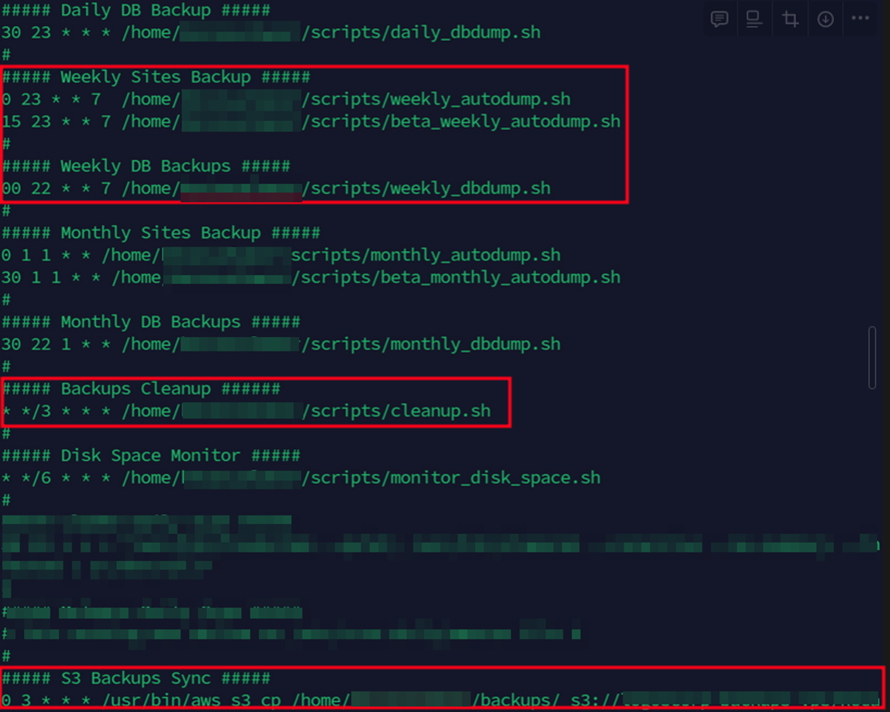

import Scrolly from "@/components/visual/Scrolly.astro";
import Step from "@/components/visual/Step.astro";
import ArchDiagram from "@/components/visual/ArchDiagram.astro";
import Chart from "@/components/visual/Chart.astro";
import StatCounter from "@/components/visual/StatCounter.astro";
import StatRow from "@/components/visual/StatRow.astro";
import Callout from "@/components/visual/Callout.astro";
import { backupDisk } from "@/data/diagrams";
import { backupDiskEs } from "@/data/diagrams.es";

Empecé a escribir estas historias porque no podía creer la cantidad de proveedores de software de mala calidad que hay. Algunos se aprovechan de dueños que no tienen la formación técnica para evaluar lo que les venden, y les cobran más por ello.

Por casualidad empecé a trabajar con una tienda de e-commerce alojada en AWS. Su proveedor anterior había montado Magento 2 y, tras un desacuerdo comercial, dejó de darle soporte. Un amigo en común nos puso en contacto. La tienda tenía tres problemas: la **factura**, los **backups** y un **servidor que se caía**.

<Scrolly>
  <ArchDiagram slot="stage" diagram={backupDisk} i18n={backupDiskEs} title="La tienda, tal como la encontré" plate="Fig. 1.1" caption="Toca o pasa el cursor sobre un componente para ver detalles." />

  <Step focus="users,ec2">
    Toda la tienda corría en una sola instancia EC2: Ubuntu, Apache, Magento. El tipo de instancia era una **c6i.2xlarge**, un monstruo para esta carga. Incluso en los días de más venta, Navidad incluida, la CPU no pasaba del 20 %. A los dueños les habían dicho que el desarrollo no funcionaría en algo más pequeño.
  </Step>

  <Step focus="ec2,disk" show="disk">
    Cuando llegué, el sitio estaba caído. Abrí SSH en el security group, reinicié el servidor e hice la ronda básica de Linux: `htop`, `df -h`, `systemctl status`, `journalctl -xe`. Los logs de Magento se quejaban de escrituras fallidas, lo que apuntaba al servidor y no al CMS. Y el disco estaba casi lleno.
  </Step>

  <Step focus="cron,ec2,disk" show="cron">
    El disco se llenaba con un horario, así que busqué una tarea programada. El crontab tenía backups diarios, semanales y mensuales de la base de datos y del sitio. Dos trabajos importaban: la **limpieza**, que nunca limpiaba nada por un error de tipeo, y el **sync a S3**.
  </Step>

  <Step focus="ec2,oldS3" show="provider,oldS3">
    El comando de sync apuntaba a un bucket que no era de la tienda. Sus backups se estaban yendo a la cuenta de AWS del proveedor anterior.
  </Step>

  <Step focus="ec2,s3,iam" show="s3,iam">
    Creé un bucket en la cuenta de la propia tienda, apunté el sync hacia él y cambié el horario a semanal los domingos y mensual el primer día de cada mes. Un **rol de IAM** asociado a la instancia le permite subir objetos a ese bucket, y nada más.
  </Step>

  <Step focus="optimizer,ec2" show="optimizer">
    Después, la factura. **Compute Optimizer** recomendó una r6i.large. La documentación de Magento prefiere instancias optimizadas para cómputo, pero la tienda tenía código propio que sincroniza Magento con su software de stock, así que mantuve la memoria: 16 GB. Con los backups hechos y una Elastic IP que mantenía estable el DNS, detuve la instancia, cambié el tipo y la volví a arrancar.
  </Step>
</Scrolly>

## Lo que decía el disco

El arreglo fue fácil una vez visto el patrón. Estas son las dos lecturas de `df -h` que tomé, una el domingo y otra el lunes por la mañana.

<Chart
  type="bar"
  title="Uso del volumen raíz, disco de 78 GB"
  plate="Fig. 1.2"
  unit="%"
  yMax={100}
  data={[
    { label: "Domingo", value: 94 },
    { label: "Lunes", value: 100 },
  ]}
  seriesLabel="Disco usado"
  caption="De df -h en /dev/root: 73 GB usados el domingo y 78 GB el lunes, cuando el backup semanal se quedó sin espacio."
/>

El crontab, con los trabajos de limpieza y de sync que importaban:

<StatRow>
  <StatCounter value={20} suffix=" %" label="pico de CPU en la c6i.2xlarge" />
  <StatCounter value={16} suffix=" GB" label="de memoria tras el ajuste de tamaño" />
  <StatCounter value={64} suffix=" %" label="menos en la factura de AWS" />
</StatRow>

<Chart
  type="bar"
  title="Factura de AWS, antes y después"
  plate="Fig. 1.3"
  yMax={100}
  data={[
    { label: "Antes", value: 100 },
    { label: "Después", value: 36 },
  ]}
  seriesLabel="Costo mensual, índice 100"
  caption="Índice, no dólares: la factura bajó un 64 % después de arreglar los backups y ajustar la instancia."
/>

## Lo que le diría a cualquier dueño de una tienda en la nube

- AWS se paga por uso, y configurarlo bien es trabajo del cliente. La configuración correcta para *tu* negocio vale dinero de verdad: aquí, el 64 % de la factura.
- Si algo en tu cuenta de AWS se ve raro, pide una segunda opinión. Hay muchos consultores cloud poco fiables. Un buen comienzo es comprobar si un proveedor que dice ser partner de AWS aparece en [partners.amazonaws.com](https://partners.amazonaws.com/).

<Callout>
  No todo buen proveedor es partner de AWS; tiene sus costos y sus trámites. Pero si *dicen* que lo son, comprobarlo toma un minuto.
</Callout>
